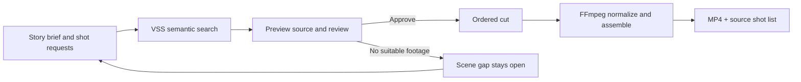

# ClipScout

Turn a shot request into reviewed footage, an ordered MP4 rough cut and a source shot list. Built for Team 32 at the VAST Builders Challenge.

**Demo:** open the workshop portal's **View app** link, or [the deployed ClipScout desk](https://team-32-app.thecosmoslabs.com/app/) with your workshop access.

## What works

1. Enter a story brief and shot requests. The starter story is **Urban movement**: cyclist, pedestrians crossing, wide highway traffic.
2. Search the actual VSS archive. Results retain the ranked segment's source, parent clip, original timecodes, camera and location.
   **Suggest story edit** sends the found candidates' descriptions to W&B inference and proposes a sequence and potential gaps. Suggestions do not change the cut or approve footage.
3. Preview a source and explicitly approve it. A request becomes covered only after editorial approval.
4. If candidates do not fit, mark a **scene gap**. The request stays open; no substitute is added automatically.
5. Reorder or remove approved shots, preview the sequence and export a silent **1280×720, 24 fps H.264 MP4** with a JSON source shot list.

The output is an archive montage. Sources can come from different places and times; it does not represent one continuous event. Capture time is not inferred from upload time.

Search runs in the background so the cut remains usable during a slow upstream response. Successful results can be reused for five minutes, with their age shown and an explicit **Refresh from archive** control. The source shot list can be downloaded independently of MP4 rendering.



## Run locally

Requirements: Python 3.10+ and FFmpeg on `PATH`. The web app uses only the Python standard library and vanilla browser JavaScript. It needs access to the team's existing VSS backend.

Set these environment variables through your local shell or secret manager, using the lab credentials supplied to your team. Do not commit their values.

| Variable | Purpose |
| --- | --- |
| `VSS_URL` | Reachable VSS backend base URL |
| `VSS_USERNAME` | Team login |
| `VSS_PASSWORD` | Team password |
| `WANDB_API_KEY` | W&B serverless inference key for editorial advice |
| `WANDB_INFERENCE_MODEL` | Optional model ID; default `meta-llama/Llama-3.1-8B-Instruct` |
| `WANDB_INFERENCE_PROJECT` | Optional W&B `team/project` for usage tracking |
| `PORT` | Optional HTTP port, default `8080` |
| `DATA_DIR` | Optional cache/export directory; default `/tmp/clipscout` |

```bash
python main.py
# Open http://localhost:8080
python -m unittest -v
```

VSS login and JWT handling stay on the server. The browser receives opaque clip IDs and same-origin media URLs.

## Deploy to the workshop

Clone this repository on the assigned lab VM and run:

```bash
bash deploy.sh
```

The script is deliberately scoped to **team-32**. It reads the existing `/config/*.config` and `/config/team-32-k8s.yaml`, discovers `video-backend-service`, and applies only ClipScout's ConfigMap, Secret, Deployment, Service and Ingress. It does not redeploy or modify the supplied VSS pipeline. Code is mounted through a ConfigMap; the container installs FFmpeg on startup. The ingress exposes `/app/` through the workshop App link.

`deploy.sh` backs up the current catalog, jobs, source lists and renders to the lab VM before replacing the app pod, then restores them and reloads the catalog. Wait for active exports to finish before deploying. If rollout fails, the backup remains under `~/.local/state/clipscout/app-data.tgz`; complete the rollout and restore that archive before deploying again. The app volume itself remains temporary: replacement outside this script can lose newer files. Download deliverables promptly. A persistent-volume trial bound successfully but failed to mount in the lab; the unused trial resources were removed.

## Repository map

| File | Responsibility |
| --- | --- |
| `main.py` | VSS proxy, source catalog, bounded render jobs and downloads |
| `index.html` | Brief, shot requests, evidence review, scene gaps and cut UI |
| `editorial_advisor.py` | W&B recommendations with validated source IDs and mandatory review |
| `deploy.sh` | Team-32 Kubernetes deployment |
| `test_main.py` | Evidence/source mapping regression checks |
| `tools/render_spike.py` | Freeze three search results, probe sources, render and extract boundary frames |
| `tools/prepare_reingest.py` | Read-only inventory and exact ten-chunk editorial plan |
| `tools/run_reingest.py` | Submit an explicitly approved plan, save submission intent and job IDs |
| `tools/verify_reingest.py` | Read-only confirmation against indexed source URIs when job progress is unavailable |
| `docs/OPERATIONS.md` | Re-ingest procedure, evaluation and demo handoff |
| `docs/render-proof.json` | Measured first render gate; no footage included |
| `docs/relevance-baseline.json` | Fifteen source-specific visual relevance labels and evaluation limits |
| `tools/prepare_visual_eval.py` | Read-only extraction of timed frames from a frozen result set |

## Scope and limits

- Browser-local drafts, not a shared multi-editor workspace. Each teammate can run the app or use the deployed desk with their own selections.
- One render at a time, up to 12 clips. MP4 exports are silent by design; some archive sources do contain audio tracks, but speech is not assumed or transcribed.
- Review is an editorial UI step, not a server-enforced approval/audit system. Similarity is a ranking score, not a confidence probability.
- Search and media depend on the workshop VSS service. Finished job records are saved on disk; interrupted renders require retrying. Uncontrolled pod replacement can still lose temporary exports. This is a workshop deployment behind the provided access boundary, not a hardened public service.
- Live-camera ingestion, standing-query triggers, replay simulation and crew dispatch are not implemented or claimed.

## Sponsored stack actually used

ClipScout calls the provided **VSS search, authentication, media and dashboard APIs**. Those results use the workshop's NVIDIA video-understanding/embedding pipeline and VAST storage/database. The editorial re-ingest was submitted to the supplied detector → reasoner → embedder → writer flow with a shot-focused custom prompt; successful indexing and prompt application are still being verified. FFmpeg creates the output cut; Codex was the development and re-ingest operator.

We do not claim an additional live-trigger integration, transcription, or sponsor tools that the application has not exercised. Source footage, credentials and private operational manifests are excluded from this repository.

**Our application-level W&B call is live-verified.** The Track B SpaceXAI/Cursor agent contributed the advisor in [PR #1](https://github.com/aswin-giridhar/token_vast_hackathon/pull/1); Track A added server/UI integration and ran it with the lab account. [Live-call evidence](docs/wandb-live-verification.json), [sponsor evidence](docs/SPONSOR_EVIDENCE.md), and [evaluation limits](docs/EVALUATION.md) document the actual use.
